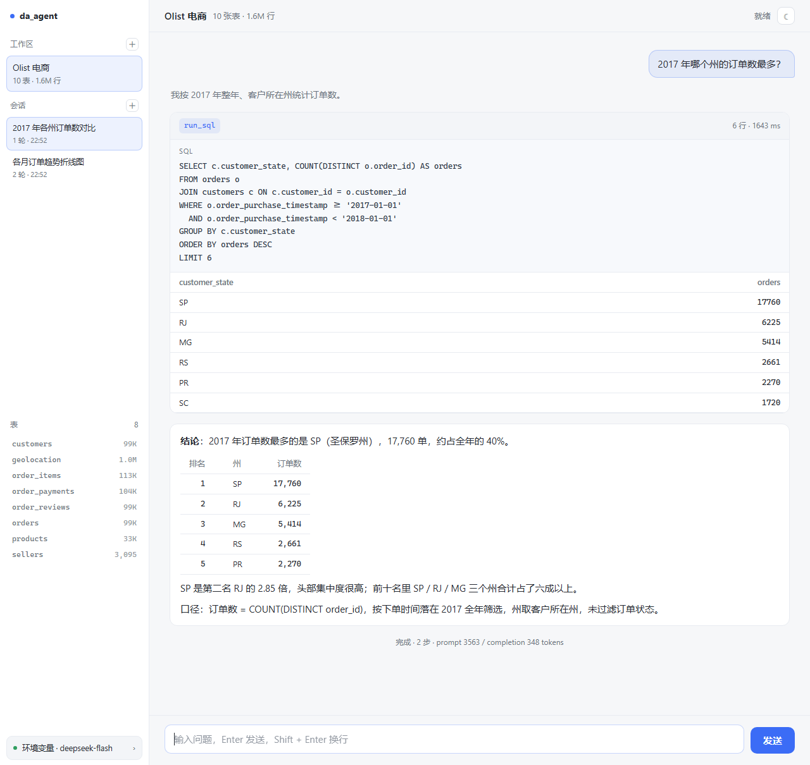
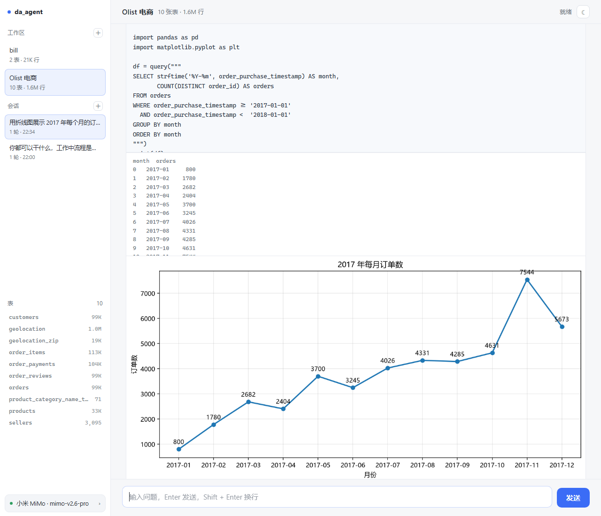

# da_agent

一个可以接**任意 SQLite 数据库**的数据分析 agent：你用中文提问，它自己写 SQL、查库、看结果、再决定下一步，最后给结论——每一步的 SQL / Python 和查询结果都摊开在你面前。



> [!IMPORTANT]
> **仓库里不含数据。**
> `data/`、`artifacts/`、`config/`、`workspaces/*/catalog.json`、`workspaces/*/sessions/` 都在 `.gitignore` 里
> （原始 CSV 约 120 MB，建好的库 168 MB）。
>
> clone 下来直接双击 `start.bat` 能启动，但**没有工作区**，你得先给它一个数据库：
> 按 [准备数据](#2-准备数据) 下载 Olist 样本，或者把自己的 `.db` 拖进来（见 [接入你自己的数据库](#接入你自己的数据库)）。

**快速跳转**：[快速开始](#快速开始) · [接入自己的库](#接入你自己的数据库) · [命令速查](#命令速查) · [工作原理](#它是怎么工作的) · [多轮对话](#多轮对话与上下文) · [设计取舍](#几个设计选择) · [已知限制](#已知限制)

---

## 它是什么

- **会自己找数**：模型通过 `run_sql` 工具逐步探索，而不是一次性写出一条巨长的 SQL
- **能写 Python 画图**：`run_python` 里可以用 pandas 处理、用 matplotlib 出图，图直接显示在对话里
- **能追问**：会话保存在本地，可以问"那 2018 年呢"，历史超预算会自动压缩
- **可以换库**：每个数据库是一个「工作区」，接入时自动分析表结构并存到本地
- **可以换模型**：网页里切换任意 OpenAI 兼容服务（DeepSeek / OpenAI / 本地 Ollama …）
- **只读安全**：查询只走只读连接，只允许单条 `SELECT`，有超时中断
- **过程透明**：答案逐字输出，每一步的 SQL / Python、返回行数、耗时都能看到，状态栏实时显示"第几步、跑了多久"，结尾标注这次用了多少上下文

**它不是什么**：不是 BI 平台，不是自动报表工具，也没有多用户和权限体系。它是一个本地单机、用来"把一次数据分析做给人看"的工具。

---

## 快速开始

### 1. 一键启动

只需要先装 **Python 3.10+**（[下载](https://www.python.org/downloads/)，Windows 安装时记得勾选 *Add python.exe to PATH*）。

- **Windows**：双击 `start.bat`
- **macOS / Linux**：`chmod +x start.sh && ./start.sh`

它按顺序做完这些事：

1. 检查 Python 版本（低于 3.10 直接告诉你）
2. 创建 `.venv` 虚拟环境
3. 安装 `requirements.txt`（官方源失败会自动切清华镜像）
4. 检查有没有数据库、有没有配模型，没有给你提示
5. 启动服务并自动打开浏览器（端口被占会自动往后找）

**第二次启动是秒开的**——依赖没变就跳过安装。想强制重装加 `--reinstall`。

```powershell
python bootstrap.py              # 安装 + 启动
python bootstrap.py --no-serve   # 只安装依赖
python bootstrap.py --port 9000  # 换个端口
```

> 无桌面环境（服务器）可以设 `DA_NO_BROWSER=1` 跳过自动开浏览器。

<details>
<summary>想手动控制环境也行</summary>

```powershell
python -m venv .venv
.\.venv\Scripts\Activate.ps1          # macOS/Linux: source .venv/bin/activate
pip install -r requirements.txt
```

</details>

### 2. 准备数据

**仓库里不含数据**：`data/`、`workspaces/*/catalog.json`、`workspaces/*/sessions/`、`artifacts/` 都在 `.gitignore` 里
（原始 CSV 约 120 MB，建好的库 168 MB，不适合进版本库）。

本项目是在 **Olist 巴西电商公开数据集** 上开发的。想复现示例，先去 Kaggle 下载
（[Brazilian E-Commerce Public Dataset](https://www.kaggle.com/datasets/olistbr/brazilian-ecommerce)），
把 9 个 CSV 解压到 `data/`，然后建库：

```powershell
.venv\Scripts\python -m da_agent.cli ingest
```

约 15 秒，产出 `data/olist.db`（10 张表 / 156 万行）和一份数据字典。

**不想用 Olist 也没关系**：跳过这步，直接接你自己的 SQLite 库，见下一节。

### 3. 配置模型

**最省事**：打开网页 → 左下角模型栏 → 「添加模型」。
里面预置了 DeepSeek、硅基流动、阿里云百炼、智谱 GLM、Kimi、小米 MiMo、OpenAI、本地 Ollama，
点一下就填好地址和模型名，你只需粘 key。填完可以点「测试连接」验一下，
模型名拿不准就点「获取列表」，会用你的 key 去服务端拉当前可用的模型 ID。

**或者用 `.env`**：复制 `.env.example` 为 `.env`，填上你的 key：

```ini
DA_LLM_BASE_URL=https://api.deepseek.com
DA_LLM_API_KEY=sk-你的密钥
DA_LLM_MODEL=deepseek-flash
DA_LLM_THINKING=disabled
```

自检：

```powershell
.venv\Scripts\python -m da_agent.cli config
```

> `.env` 和 `config/` 都在 `.gitignore` 里，密钥不会进版本库。

### 4. 跑起来

**网页**

```powershell
.venv\Scripts\python -m da_agent.cli serve
# 打开 http://127.0.0.1:8123
```

或者直接双击 `start.bat`（它会自己搞定这些）。

**命令行**

```powershell
.venv\Scripts\python -m da_agent.cli ask "2017 年哪个州的订单数最多？"
```

---

## 接入你自己的数据库

任何 SQLite 文件都行（`.db` / `.sqlite` / `.sqlite3`）。

**网页**：左侧栏点 `＋`，填文件路径。

**命令行**：

```powershell
.venv\Scripts\python -m da_agent.cli ws add D:\data\mydb.db --name "我的业务库"
```

它会做三件事：

1. 开只读连接扫出所有表和视图
2. 逐列统计类型、行数、空值率、唯一值、样本值
3. 把结果写进 `workspaces/<id>/`，并自动切过去

接入后，对话页的示例问题会按这个库的结构**自动生成**（取时间列、分类列、数值列拼出来），不会再出现"哪个州订单最多"这种跟你的库完全不搭的提示。

```
workspaces/
  olist/
    workspace.json   # 元数据（名字、库路径、创建时间）
    catalog.json     # 数据字典（自动生成，可重建）
    notes.md         # 业务知识（人写，不会被覆盖）
```

**`notes.md` 是这个设计里最有用的部分**：自动分析只能看出「`customer_id` 值唯一」，看不出「它其实是每单一个号、不是真客户」。把你踩过的坑写进去，agent 每次都会读到。

---

## 命令速查

| 命令 | 作用 |
|---|---|
| `bootstrap.py [--no-serve] [--port N]` | 一键装依赖并启动（`start.bat` / `start.sh` 就是调它） |
| `profile [-d]` | 扫描 CSV，看行数/类型/空值率 |
| `ingest` | CSV → SQLite，并同步工作区 |
| `ws list` | 列出工作区（`●` 是当前） |
| `ws add <路径> [--name]` | 接入新数据库并自动分析 |
| `ws use <id>` | 切换工作区 |
| `ws show [id]` | 看表清单、业务笔记、自动生成的示例问题 |
| `ws refresh [id]` | 数据结构变了之后重新分析 |
| `ws remove <id>` | 移除工作区（只删字典/笔记/会话，不动你的 `.db`） |
| `sql "<查询>" [--ws id]` | 手动跑一条只读 SQL |
| `ask "<问题>" [--ws id] [--session id]` | 提问，看完整过程（带 `--session` 继续上次） |
| `serve [--port] [--host]` | 启动网页 |
| `model list / add / use` | 管理模型配置 |
| `config` | 检查模型、工作区、密钥状态 |

> 命令都要用虚拟环境里的解释器：Windows 是 `.venv\Scripts\python -m da_agent.cli ...`，
> macOS/Linux 是 `.venv/bin/python -m da_agent.cli ...`。激活过 venv 的话直接 `python -m da_agent.cli` 也行。

网页里的调试开关：

```
?demo=1              预置一段对话，不发请求，专门调样式
?demo=1&theme=dark   直接看深色
?fake=1              真发请求但用假模型，不花 token
```

---

## 它是怎么工作的

```
        你提问
          │
          ▼
   ┌──────────────┐  工具调用   ┌──────────────┬────────────────┐
   │  agent loop  │ ─────────▶ │   run_sql    │   run_python   │
   │  (推理)      │ ◀───────── │  只读 SQL    │ pandas/matplotlib│
   └──────┬───────┘  结果+摘要   └──────────────┴────────────────┘
          │
          │ 事件流（纯 JSON）
          ▼
    ┌──────────┬───────────┐
    │  CLI     │  Web(SSE)  │
    └──────────┴───────────┘
```

两个工具的分工：

| 工具 | 干什么 | 什么时候用 |
|---|---|---|
| `run_sql` | 一条只读 SELECT | 取数、过滤、join、聚合——能用 SQL 表达的都用它 |
| `run_python` | 独立子进程跑 pandas / matplotlib | 透视、重采样、统计、**以及画图** |

`run_python` 里预置了 `pd` / `np` / `plt`，还有 `query(sql)` 直接拿 DataFrame。
画完不用 `plt.show()`：脚本结束时所有开着的图会自动存到 `artifacts/<工作区>/runs/` 并显示在对话里。



核心是**一个内核，多个前端**：`loop.run()` 只负责推理并吐出事件，CLI 和浏览器各自渲染同一批事件。加一个新界面不需要改任何业务逻辑。

事件类型：`context` / `run_start` / `step` / `token` / `text` / `tool_call` / `tool_result` / `answer` / `run_end` / `error`。

一次问答的上下文长这样（`artifacts/traces/*.jsonl` 里存的就是完整版）：

```
system     表结构 + 工作规则 + 你的 notes.md
user       2017 年哪个州的订单数最多？
assistant  （空文本 + 一个 tool_call）
tool       {"ok": true, "columns": ["customer_state","orders"], "rows": [...]}
assistant  结论……
```

---

## 多轮对话与上下文

会话存在 `workspaces/<id>/sessions/<会话id>.json`，里面是标准的 messages 列表（不含 system）。

追问时服务端把历史拼到新问题前面。历史会无限长，所以每次请求前按预算裁剪：

| 级别 | 触发 | 做什么 |
|---|---|---|
| 0 | 预算内 | 原样发送 |
| 1 | 超预算 | 旧轮次只留「问题 + 结论」，丢掉工具调用和原始数据 |
| 2 | 还不够 | 最老的整轮丢掉，压成摘要写进系统提示 |

最近 **2 轮永不压缩**——它们是"当前正在聊什么"，丢了对话就断片。

预算默认 20000 tokens，用 `DA_CONTEXT_BUDGET` 调。压缩是**确定性**的（不额外调模型），免费且可预测。发生压缩时界面会显示一行提示。

侧栏可以看会话列表、点开回看；`?ws=<工作区>&session=<会话id>` 能直接打开某次对话。

---

## 目录结构

```
bootstrap.py     一键安装依赖并启动
start.bat        Windows 双击入口
start.sh         macOS / Linux 入口

da_agent/
  config.py      路径与配置（唯一知道"文件在哪"的地方）
  workspace.py   工作区：目录结构、数据库画像
  schema.py      Olist 的表定义（建库用）
  inspect.py     CSV 画像
  ingest.py      CSV → SQLite
  db.py          只读查询：围栏 / 超时 / 错误提示
  python_exec.py Python 子进程：pandas / matplotlib，收集产物
  context.py     把数据字典压成系统提示
  llm.py         OpenAI 兼容的 /chat/completions（手写 HTTP）
  loop.py        主循环
  models.py      模型档案（多套配置）
  trace.py       事件流落盘
  server.py      FastAPI + SSE
  cli.py         命令行
  tools/         工具注册表（run_sql / run_python）

web/             前端（原生 ES module，无构建步骤）
  index.html
  style.css
  js/app.js      状态、对话流、侧栏、弹窗
  js/markdown.js 纯函数：迷你 markdown 渲染

data/            原始 CSV 与建好的库（gitignored）
workspaces/      每个数据库一份：元数据 + 字典 + 笔记 + 会话（多数 gitignored）
artifacts/       traces、Python 产物、截图（gitignored）
docs/            方案文档、README 用的截图
```

---

## 几个设计选择

**为什么手写 HTTP 而不是用 openai SDK**
协议本质就是「POST 一段 JSON，拿回一段 JSON」。写一遍就知道换服务商该改哪三处，出问题也能直接看到请求和响应原文。

**为什么结果只回摘要**
`SELECT *` 可能返回百万行。工具默认只回 30 行并标注是否截断——模型的上下文是钱，也是注意力。

**为什么把表结构写进系统提示**
给模型一个 `describe_table` 工具让它自己探，要花 2~3 轮请求。表结构固定，一次写进去更便宜也更快，而且稳定前缀能命中 prompt cache（DeepSeek 缓存命中价差 50 倍）。

**为什么 `ToolContext` 要单独传**
工具函数不读全局变量，而是接收「这次查哪个库」。这样同一进程能服务多个工作区，测试也能塞临时库进去。

**为什么 SQL 不折行**
窄屏下折行的 SQL 会变成碎片，完全没法读。宁可横向滚动。

---

## 已知限制

| 限制 | 说明 |
|---|---|
| `run_python` 不是沙箱 | 模型写的代码就在你的账户下跑（能读写文件、能联网）。它防的是手滑和忘了关的循环，不防恶意代码 |
| Linux 上缺中文字体 | 图里的中文会变方块。装一下 `fonts-noto-cjk`（Debian/Ubuntu: `sudo apt install fonts-noto-cjk`）即可，代码里已按 PingFang / YaHei / SimHei / Noto 的顺序回退 |
| Python 产物会累积 | 每次执行的结果在 `artifacts/<工作区>/runs/` 下，目前不自动清理 |
| 只支持 SQLite | MySQL/Postgres 需要另写方言适配层 |
| 模型档案明文存 `config/models.json` | 本地工具，靠 `.gitignore` 兜底；不要在共享机器上用 |
| 大表跳过精确基数 | 超过 20 万行不算 `COUNT(DISTINCT)`，字典里标注「未统计」 |
| 单用户 | 没有鉴权，不要把端口暴露到公网 |

---

## 接下来

- [x] 多轮会话（追问、上下文压缩）
- [x] 图表工具（`run_python` + matplotlib，图直接显示在对话里）
- [x] 会话历史与回放（侧栏列表 + `?session=` 深链）
- [x] 工作区侧栏、模型切换、一键安装
- [ ] 导出报告（结论 + 图表 + SQL 打包成 markdown）
- [ ] 产物面板（右侧集中展示一次会话生成的所有图）
- [ ] 更多数据源（CSV / Parquet / Postgres）
- [ ] 产物自动清理（现在 `artifacts/<工作区>/runs/` 会一直累积）

---

## 说明

这是一个以**学习和理解 agent 原理**为主的项目：循环、上下文、工具、事件流都是手写的，没有用 LangChain 之类的框架。每一步的设计取舍都写在了代码注释里。

初版方案文档见 [docs/PLAN.md](docs/PLAN.md)（部分内容已被实际实现取代）。
